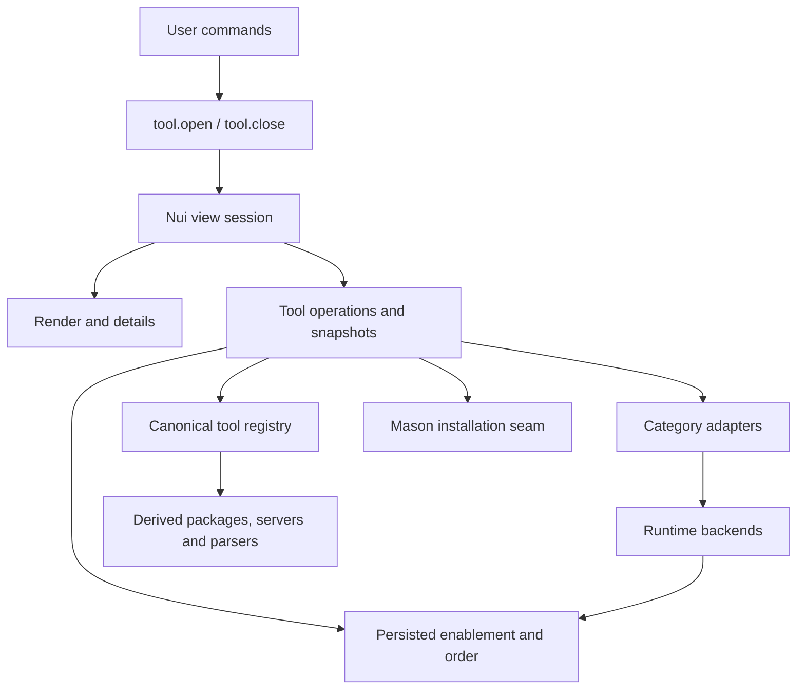

# Architecture

OrbitVim separates declarative configuration from runtime activation. `init.lua` applies editor options and settings before Lazy, imports the plugin specs, then registers commands and finishes theme, shell, highlight and general-key setup. A fresh Lazy clone checks out the revision in `lazy-lock.json` before it loads.

Plugin specs declare identity, dependencies, loading triggers, keys and lifecycle callbacks. Editable options live in `lua/config/`; activation lives in `lua/runtime/` or the feature's owner, which the lifecycle callbacks call.

## Settings

`config.settings` resolves `settings.json` against the bundled schema before plugin setup and validates tool and server IDs against the registry. `core.settings` applies live changes transactionally and observes saves to the exact settings path; restart-only changes stay pending. `commands.settings` registers `:OrbitSettings`. The [settings guide](settings.md) defines scope, precedence and recovery.

## Tool Manager

`config.tools` is the single registry of logical tool IDs, supported filetypes, backend aliases, installers and default order. `config.packages` derives sorted, unique package, server and parser lists from it.

`tool.manager` takes selections by category, logical name and optional filetype, and checks capabilities before changing state or calling installers. Its snapshots carry tool status, structured health, filetype groups and summaries, never Nui nodes, cursor positions or highlight offsets.

`tool.state` reads current and legacy JSON and persists logical IDs. Each write takes an exclusive lock and rereads disk state before merging its field. `tool.order` reconciles saved and default order with the current candidates. Category adapters translate backend identifiers at the runtime boundary and preserve unrelated runtime entries. Formatter and linter adapters re-enable a tool only on filetypes that `config.formatter` / `config.linter` activate initially, matching startup. Health checks use the captured source buffer. DAP activation is shared with `runtime.dap`; parser installation uses Tree-sitter's async result.

`tool.ui.view` owns one session: Nui layout and popups, view mode, source context, selection, mappings, subscriptions, timers and the details preview. `tool.ui.render` builds Nui tree content; `tool.ui.details` renders health and selected-tool information. Glyphs come from `config.icons`; mappings and help text come from `config.tool_manager`.

An operation can outlive its view. Its completion updates state and runtime but refreshes only the session that started it, and only while that session is open.

## Runtime owners

- `runtime.lsp` registers servers, diagnostics and optional features, and merges client capabilities from Blink; `runtime.lsp.client` owns client lifecycle and capability events, with private method-tracking state and idempotent setup.
- `runtime.completion.blink` owns Blink setup and resize subscriptions; `utils.cmp` holds completion and snippet actions and their dispatch order.
- `runtime.treesitter` owns parser start, SQL predicates and SQL syntax fallback.
- `runtime.harpoon` owns list items, selection highlighting and setup; `runtime.ui` coordinates Snacks and Trouble setup.
- `runtime.completion` builds LuaSnip, linking the running Neovim's directory on Windows; `runtime.markdown` waits for the preview installer and checks its executable version. Both run argument lists directly, independent of the interactive shell.
- `runtime.notes` installs one Markdown highlight override from `lua/config/notes/markdown.scm` that keeps code fences visible at `conceallevel=2`. Upstream query changes need review against it.
- `core.shell` chooses Windows shell and compiler defaults while keeping explicit choices.

UI options live in `lua/config/ui/`; navigation, completion, Git and notes options have their own `lua/config/` modules.

The separation of state, actions and rendering follows [lazy.nvim](https://github.com/folke/lazy.nvim/tree/main/lua/lazy) and [mason.nvim](https://github.com/mason-org/mason.nvim/tree/main/lua/mason). [Nui](https://github.com/MunifTanjim/nui.nvim) supplies the UI components.
