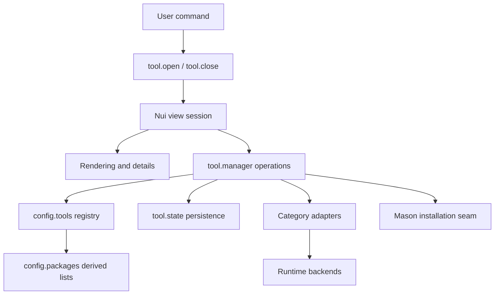

# Architecture

`init.lua` applies editor options and settings. It bootstraps the locked Lazy revision and imports plugin specs. Then it registers commands and finishes theme, shell, highlights and general mappings. Plugin imports describe loading. Their lifecycle callbacks give activation to feature owners.

Editable options live under `lua/config/`. Lazy metadata lives under `lua/plugins/`, and backend activation under `lua/runtime/`. Shared helpers expose concrete local interfaces without forwarding facades.

## Settings

`config.settings` validates personal JSON against the bundled schema and registry before plugins load. `core.settings` applies live changes with rollback. It observes saves to the exact configured path. `commands.settings` gives the settings editor and the effective-value view. [Settings](settings.md) defines precedence and recovery.

## Tool Manager

`config.tools` owns logical IDs, supported filetypes, backend aliases, installers and default order. `config.packages` derives sorted, unique server, package and parser lists.

`tool.manager` accepts category, logical tool name and optional filetype. It checks capabilities before a state change or an installation. Snapshots contain status, health and groups without Nui nodes or cursor coordinates.

`tool.state` reads current or legacy JSON. A write locks the file and reads the current disk state again before it merges one change. `tool.order` reconciles saved order with current candidates. Category adapters translate aliases at the runtime boundary. They keep unrelated backend entries. When formatters and linters are enabled again, they obey the initial activation in `config.formatter` and `config.linter`. They do not activate all supported filetypes.

`tool.ui.view` owns layout, source context, selection, mappings, subscriptions, timers and details for one session. Render and details modules produce its content. Icons come from `config.icons`. Mappings and help come from `config.tool_manager`.

An asynchronous operation can outlive the view. On completion, it updates state and runtime. Then it refreshes only the session that started it, if that session is still open. See [Tool Manager](tool-manager.md) for user-visible behavior.

## Runtime boundaries

| Owner | Responsibility |
| --- | --- |
| `runtime.lsp` / `runtime.lsp.client` | Server setup, Blink capabilities, diagnostics, client lifecycle and capability events |
| `runtime.completion.blink` / `utils.cmp` | Blink setup and resize subscriptions / completion and snippet action order |
| `runtime.treesitter` | Parser startup, SQL injection predicates and syntax fallback |
| `runtime.dap` | Shared debugger activation |
| `runtime.harpoon` / `runtime.ui` | Harpoon list state / Snacks and Trouble setup |
| `runtime.completion` / `runtime.markdown` | Native LuaSnip build / preview installer and executable validation |
| `runtime.notes` | Markdown highlight override that preserves fences at `conceallevel=2` |
| `core.shell` | Windows shell and compiler defaults while preserving explicit choices |

Native build owners execute argument lists without the interactive shell. On Windows, LuaSnip links the running Neovim directory. When upstream queries change, review the notes highlight override against them.

The state/action/render split follows [lazy.nvim](https://github.com/folke/lazy.nvim/tree/main/lua/lazy) and [mason.nvim](https://github.com/mason-org/mason.nvim/tree/main/lua/mason). [Nui](https://github.com/MunifTanjim/nui.nvim) owns UI components.

Harpoon mappings belong to the Lazy spec. Its runtime receives display options directly and owns list construction and highlighting.

Blink documentation uses its supplied renderer. Live resize needs the pinned revision's private window objects. The completion runtime contains that dependency. Noice progress adaptation stays in `utils.progress`. Integration checks exercise the installed plugin interfaces.
