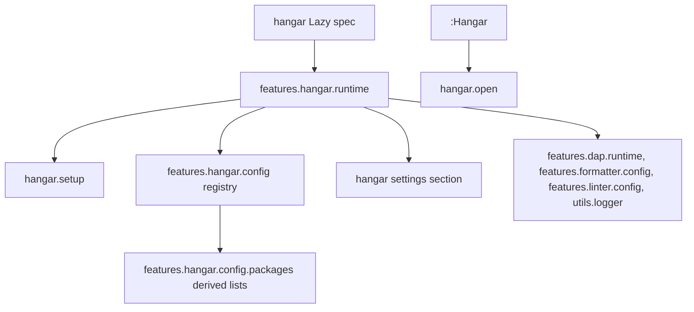

# Architecture

`init.lua` applies editor options and settings. It bootstraps the locked Lazy revision and imports plugin specs. Then it registers commands and finishes theme, shell, highlights and general mappings. Plugin imports describe loading. Their lifecycle callbacks give activation to feature owners.

Each feature lives under `lua/features/<name>/`. Fixed entry names separate editable declarations from activation.

## Layout

| Entry | Responsibility |
| --- | --- |
| `spec.lua` | Lazy loading declarations |
| `config.lua`, `config/` | Editable options, declarations and assets |
| `runtime.lua`, `runtime/` | Activation and resource lifetime |
| `commands.lua` | Feature commands and their mappings |

Keep feature directories free of `init.lua` files. Import another feature's declarations or public runtime functions directly.

`lua/plugins/init.lua` imports each feature spec explicitly. Lazy tracks these modules for change detection. Spec imports do not load runtime owners or register editor resources.

Core owns editor options, autocommands, filetypes and mappings. It also owns shell setup, Lazy options and the command registration list. Shared owns borders and icons. Utils holds helpers that have no feature owner. Keep `lua/chadrc.lua` at the top level for nv-ui.

## Startup

- Keep editor setup, Lazy bootstrap and final UI setup in that order.
- Let plugin specs declare loading and plugin keys. Let their lifecycle callbacks call runtime owners.
- Do not register commands, events or mappings, or load highlight caches, during spec import.
- Treat configuration templates under `lua/features/*/config/template/` as reusable files.
- Keep project-root precedence in `utils.project` stable when you change discovery helpers.

## Settings

`features.settings.config` validates personal JSON against the bundled schema and registry before plugins load. `features.settings.runtime` applies live changes with rollback. It observes saves to the exact configured path. `features.settings.commands` gives the settings editor and the effective-value view. [Settings](settings.md) defines precedence and recovery.

## Hangar

[hangar.nvim](https://github.com/Orbit-Lua/hangar.nvim) provides the tool view, operations and state. Its [guide](https://github.com/Orbit-Lua/hangar.nvim/blob/0a78244ecfb5c84ac4160653a12c39b22a8dc237/doc/guide.md) defines that behavior. Its [architecture](https://github.com/Orbit-Lua/hangar.nvim/blob/0a78244ecfb5c84ac4160653a12c39b22a8dc237/doc/architecture.md) defines plugin internals.

The hangar spec loads at startup with `lazy = false`. Its `config` calls `features.hangar.runtime.setup()`. LSP, formatter, linter and DAP read tool state on later events.

`features.hangar.runtime` passes the registry, default orders from settings and the `hangar.json` path. The `hangar` settings section becomes the view options. It also passes the border, DAP owner, formatter and linter activation, and linter logs. Every view default and icon comes from hangar.nvim. When the section changes, `features.settings.runtime` calls `hangar.update_ui()`, which rebuilds the options and refreshes the open view.

`features.hangar.config` owns logical IDs, supported filetypes, backend aliases, installers and default order. `features.hangar.config.packages` derives sorted, unique server, package and parser lists. When formatters and linters are enabled again, they obey the initial activation in `features.formatter.config` and `features.linter.config`. They do not activate all supported filetypes.

## Runtime boundaries

| Owner | Responsibility |
| --- | --- |
| `features.lsp.runtime` / `features.lsp.runtime.client` | Server setup, Blink capabilities, diagnostics, client lifecycle and capability events |
| `features.completion.runtime.blink` / `utils.cmp` | Blink setup and resize subscriptions / completion and snippet action order |
| `features.treesitter.runtime` | Parser startup, SQL injection predicates and syntax fallback |
| `features.dap.runtime` | Shared debugger activation |
| `features.navigation.runtime` | Harpoon list state |
| `features.snacks.runtime` | Snacks setup and redraw recovery |
| `features.diagnostics.runtime` | Trouble references view |
| `features.completion.runtime` / `features.markdown.runtime` | Native LuaSnip build / preview installer and executable validation |
| `features.notes.runtime` | Markdown highlight override that preserves fences at `conceallevel=2` |
| `core.shell` | Windows shell and compiler defaults while preserving explicit choices |

Native build owners execute argument lists without the interactive shell. On Windows, `:ClearShada` keeps `main.shada` while it removes temporary ShaDa files. On Windows, LuaSnip links the running Neovim directory. When upstream queries change, review the notes highlight override against them.

Harpoon mappings belong to the Lazy spec. Its runtime receives display options directly and owns list construction and highlighting.

Blink documentation uses its supplied renderer. Live resize needs the pinned revision's private window objects. The completion runtime contains that dependency. Noice progress adaptation stays in `utils.progress`. Integration checks exercise the installed plugin interfaces.

## Runtime contracts

- Keep formatting from writing source files or discarding later edits.
- Complete progress once on success, failure and buffer disposal.
- Invalidate delayed LSP work after detach or buffer deletion.
- Preserve server-owned initialization hooks and semantic-token policy.
- Keep linter debouncing, slow-linter policy and Windows CRLF normalization.
- Build each buffer-dependent linter definition once per execution.
- Keep automatic linting and custom parser activation disabled for detected large files.

## Project conditions

`utils.project.tool_root(filename, tool)` checks package declarations and tool configuration from the source file's ancestors. It preserves the existing project-root precedence.

The nearest `.git`, `.hg`, `.svn` or `.bzr` marker bounds the search. Nested packages can inherit evidence within that repository. Sibling packages are not searched. Without a repository marker, the nearest package manifest or tool configuration bounds the search.

Tailwind accepts its package declaration, Tailwind configuration, Django configuration paths and Tailwind dependency entries in Elixir or Ruby lockfiles. PostCSS configuration alone does not qualify. ESLint accepts its package declaration or a flat configuration file. Missing or malformed manifests supply no package evidence.

LSP server declarations can supply a buffer-scoped `condition`. The runtime checks it before calling the effective upstream root resolver. Repeated setup replaces the condition. ESLint linter and formatter conditions use the same project query. Their executable and working directory follow the captured source file, including hoisted workspace binaries.

Conditions govern new startup and execution attempts. They do not change saved tool enablement or installation state. Existing clients, published diagnostics and pending lint results keep their current lifetime. Manifest changes are checked on later attempts without a permanent miss cache.

## Shared tasks

Several plugins can do the same task. This table gives each task one owner.

| Task | Owner | Not used for this task |
| --- | --- | --- |
| Terminals | `utils.term`, with NvChad `term` options from `chadrc.lua` | Snacks terminal |
| File tree | nvim-tree | Snacks explorer, which is disabled |
| Floating file browser | oil.nvim | |
| Messages, command line and LSP progress | Noice | |
| Notification display | Snacks notifier | |
| Indent guides | indent-blankline (IBL) | Snacks indent, which is disabled |
| Large-file detection | Snacks bigfile | |
| Debug adapter core | `Orbit-Lua/nvim-dap` fork | `mfussenegger/nvim-dap` |
| File marks | `Orbit-Lua/harpoon` fork | `ThePrimeagen/harpoon` |
