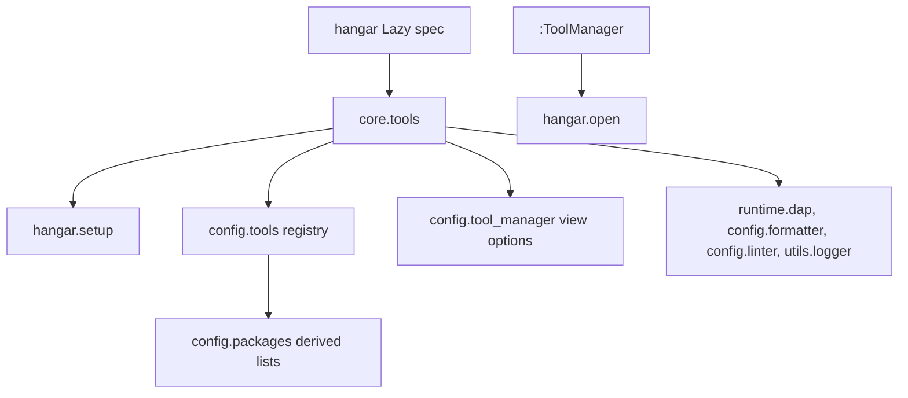

# Architecture

`init.lua` applies editor options and settings. It bootstraps the locked Lazy revision and imports plugin specs. Then it registers commands and finishes theme, shell, highlights and general mappings. Plugin imports describe loading. Their lifecycle callbacks give activation to feature owners.

Editable options live under `lua/config/`. Lazy metadata lives under `lua/plugins/`, and backend activation under `lua/runtime/`. Shared helpers expose concrete local interfaces without forwarding facades.

## Startup

- Keep editor setup, Lazy bootstrap and final UI setup in that order.
- Let plugin specs declare loading and plugin keys. Let their lifecycle callbacks call runtime owners.
- Do not register commands, events or mappings, or load highlight caches, during spec import.
- Treat configuration templates under `lua/config/*/template/` as reusable files.
- Keep project-root precedence in `utils.project` stable when you change discovery helpers.

## Settings

`config.settings` validates personal JSON against the bundled schema and registry before plugins load. `core.settings` applies live changes with rollback. It observes saves to the exact configured path. `commands.settings` gives the settings editor and the effective-value view. [Settings](settings.md) defines precedence and recovery.

## Tool Manager

[hangar.nvim](https://github.com/Orbit-Lua/hangar.nvim) provides the Tool Manager view, operations and state. See its guide and architecture for that behavior.

The hangar spec loads at startup with `lazy = false`. Its `config` calls `core.tools.setup()`. The readers of tool state in `runtime.lsp`, `runtime.formatter`, `runtime.linter` and the DAP spec load later on events, so they find hangar configured.

`core.tools` passes the registry, default orders from settings, the `tools.json` path and the legacy `service.json` path. It also passes the view options, icons, border, DAP owner, formatter and linter activation, and linter logs. `config.tool_manager` goes by reference, so `core.settings` updates the open view in place and fires `User HangarChanged`.

`config.tools` owns logical IDs, supported filetypes, backend aliases, installers and default order. `config.packages` derives sorted, unique server, package and parser lists. When formatters and linters are enabled again, they obey the initial activation in `config.formatter` and `config.linter`. They do not activate all supported filetypes.

## Runtime boundaries

| Owner | Responsibility |
| --- | --- |
| `runtime.lsp` / `runtime.lsp.client` | Server setup, Blink capabilities, diagnostics, client lifecycle and capability events |
| `runtime.completion.blink` / `utils.cmp` | Blink setup and resize subscriptions / completion and snippet action order |
| `runtime.treesitter` | Parser startup, SQL injection predicates and syntax fallback |
| `runtime.dap` | Shared debugger activation |
| `runtime.harpoon` / `runtime.ui` | Harpoon list state / Snacks and Trouble setup |
| `runtime.completion` / `runtime.markdown` | Native LuaSnip build / preview installer and executable validation |
| `runtime.notes` | Markdown highlight override that preserves fences at `conceallevel=2` |
| `core.shell` | Windows shell and compiler defaults while preserving explicit choices |

Native build owners execute argument lists without the interactive shell. On Windows, `:ClearShada` keeps `main.shada` while it removes temporary ShaDa files. On Windows, LuaSnip links the running Neovim directory. When upstream queries change, review the notes highlight override against them.

The state/action/render split follows [lazy.nvim](https://github.com/folke/lazy.nvim/tree/main/lua/lazy) and [mason.nvim](https://github.com/mason-org/mason.nvim/tree/main/lua/mason). [Nui](https://github.com/MunifTanjim/nui.nvim) owns UI components.

Harpoon mappings belong to the Lazy spec. Its runtime receives display options directly and owns list construction and highlighting.

Blink documentation uses its supplied renderer. Live resize needs the pinned revision's private window objects. The completion runtime contains that dependency. Noice progress adaptation stays in `utils.progress`. Integration checks exercise the installed plugin interfaces.

## Runtime contracts

- Keep formatting from writing source files or discarding later edits.
- Complete progress once on success, failure and buffer disposal.
- Invalidate delayed LSP work after detach or buffer deletion.
- Preserve server-owned initialization hooks and semantic-token policy.
- Keep linter debouncing, slow-linter policy and Windows CRLF normalization.
- Build each buffer-dependent linter definition once per execution.
- Keep automatic linting and custom parser activation disabled for detected large files.

## Shared tasks

Several plugins can do the same task. This table gives each task one owner.

| Task | Owner | Not used for this task |
| --- | --- | --- |
| Terminals | `utils.term`, with NvChad `term` options from `chadrc.lua` | Snacks terminal |
| File tree | nvim-tree | Snacks explorer, which is disabled |
| Floating file browser | oil.nvim | |
| Messages, command line and LSP progress | Noice | |
| Notification display | Snacks notifier | |
| Indent guides | indent-blankline (IBL) | Snacks indent, which is disabled |
| Large-file detection | Snacks bigfile | |
| Debug adapter core | `Orbit-Lua/nvim-dap` fork | `mfussenegger/nvim-dap` |
| File marks | `Orbit-Lua/harpoon` fork | `ThePrimeagen/harpoon` |
